<p align="center">
  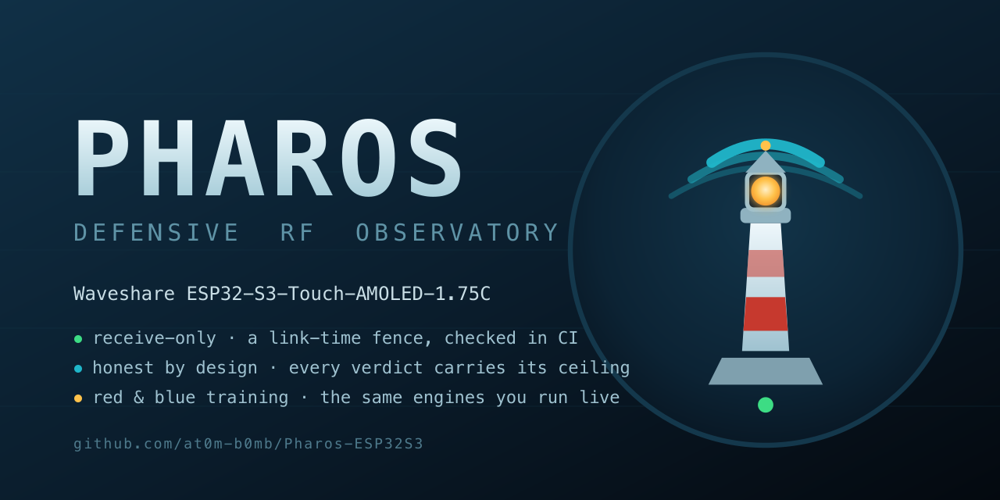
</p>

<h1 align="center">Pharos</h1>

<p align="center">
  <b>A defensive, receive-only RF observatory for the Waveshare ESP32-S3-Touch-AMOLED-1.75C.</b><br>
  A lighthouse that listens: it watches the 2.4&nbsp;GHz air, grades what it hears, and is honest about what it cannot.
</p>

<p align="center">
  <a href="https://at0m-b0mb.github.io/Pharos-ESP32S3/"></a>
  <a href="#the-transmit-fence"></a>
  
  
  
  
</p>

---

## What it is

Pharos turns a £40 round-screen dev board into a **touch-first instrument for lawful wireless defence and training**. It is built for the two people who should own a tool like this:

- **the blue-teamer** walking a site, who needs to know if somebody is knocking clients off the Wi-Fi, whether the access points are configured the way policy says, and what the room is leaking; and
- **the learner** — red or blue — who needs to *understand* those attacks on real instrumentation without a lab full of gear, and without ever transmitting a frame.

It is inspired by the usability and extensibility of the Evil-M5Project, and deliberately takes the opposite stance on one thing: **Pharos cannot transmit.** Not "does not by default" — *cannot*. That is enforced by the build, checked in CI, and provable on the device's own screen. See [the transmit fence](#the-transmit-fence).

> [!IMPORTANT]
> **Authorisation first.** Even passive monitoring is regulated in some places, and *acting* on what you find is your responsibility. Use Pharos only on networks and in engagements you are authorised to assess. Read [docs/SAFETY.md](docs/SAFETY.md) before you switch it on.

## Why it is different

Most hobby RF tools answer "is there an attack?" with a confident yes/no. Pharos will not, because the hardware will not let it be honest that way:

> The ESP32-S3 has **one receiver**. To cover 2.4 GHz it hops, so it hears roughly **7% of any one channel** at a time. Multiplying an observed count by fourteen gives an *estimate*, not a *measurement*.

So every verdict Pharos produces carries a **confidence ceiling** derived from how much of the channel it actually heard. A deauth flood reads `FLOOD LIKELY` when you camp on its channel and only `SUSPICIOUS` when you keep hopping — the same traffic, a different honesty. There is no band named "safe". Absence of evidence on a receiver that hears 7% of the air is not evidence of absence, and the firmware never pretends otherwise.

But the ceiling has to punish the **right** thing, and that distinction is the heart of the Watch engine. Hopping weakens an *extrapolated rate* — you heard 7% of a second and multiplied by fourteen. It does not weaken a **contradiction**. If a network advertises that its management frames are cryptographically protected (802.11w), then an *unprotected* deauthentication frame claiming to come from it is forged, and hearing it during a 200 ms visit makes it no less forged. Evidence like that is dwell-independent, and Pharos says so: such a verdict raises its own ceiling to 88 and may alarm while hopping. Nothing ever reaches 100.

This honesty is not a disclaimer bolted on. It is arithmetic, and it is [tested](test/host): 15,227 host checks assert, among much else, that volume and targeting shape **together** can never reach the alarm band — a busy network is not an attack — and that every forgery test has a benign twin it must refuse to fire on.

## What it looks like

Every screenshot below is **generated from the firmware's own code** — the real
`pharos_round`/`pharos_style` geometry, driven by the real detection engines, fed
by the real training scenarios. Nothing here is a mock-up drawn in a design tool.

<p align="center">
  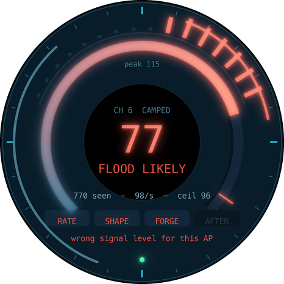
  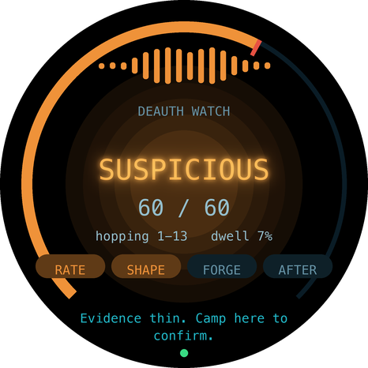
  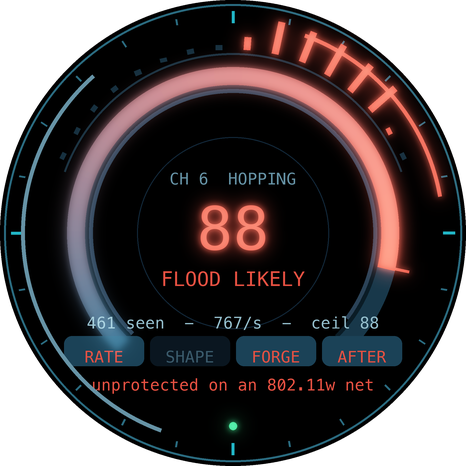
</p>

**These three are the whole argument.** The first two are the *identical event
stream*. Camped on the channel the Watch engine reaches `FLOOD LIKELY` at 88;
hopping across 1–13 the same evidence tops out at `SUSPICIOUS` at 60, with the
red ceiling tick sitting right on the score — you are not entitled to claim
more.
That attacker rode the access point's own sequence counter and gave away only
its position, which is a *measurement*, and measurements are what hopping ruins.

The third is a different attack against a network that **requires** protected
management frames. The unprotected disconnects are then a contradiction rather
than an estimate, so the same hopping receiver alarms at 88.

Around the top of each face, sixteen bars are the last sixteen seconds of
disconnect traffic — because a steady trickle and one violent burst produce the
same ten-second average and are not the same event. The four **named chips** say
what the evidence actually was: `RATE`, `SHAPE`, `FORGE`, `AFTER`. "Why does it
think so" is answerable from the glass, not from the manual.

### It teaches itself

A device with twenty-one tools, four verdict colours and a touch surface with
no visible buttons cannot be learned by poking at it. The console banner
explained the controls, which is no help at all to somebody holding the device
and looking at the *glass*.

So on first boot the glass explains itself — nine steps, once, remembered in
NVS, replayable forever with `guide` on the console.

<p align="center">
  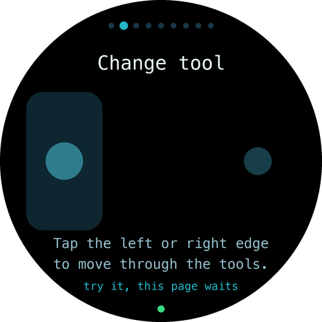
  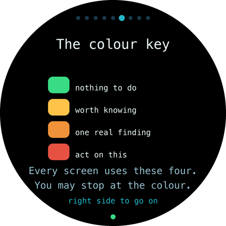
  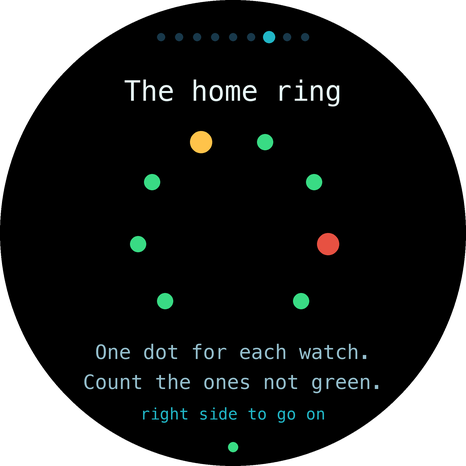
</p>

Each step **shows the gesture rather than describing it** — the outline of a
zone appears and a fingertip pulses inside it, travelling between the two side
zones for the one that has two. You copy what you just watched instead of
skimming a sentence about it. The order is controls first (you cannot explore
without them), then the colour key (it is the key to every other screen), then
the two pieces of vocabulary that are genuinely unusual: the ring of dots and
the evidence chips.

Anyone who already knows the device leaves in one press.

### Touch, in full

|  | Ordinary pages | Detail page |
|---|---|---|
| **left edge** | previous tool | page up |
| **right edge** | next tool | page down |
| **centre** | start the tool | open the focused row |
| **bottom strip** | show the evidence | — |
| **anywhere, held** | stop and step back | stop and step back |

On **Home**, tapping a watch dot jumps straight to that watch and tapping the
middle opens the Survey. The physical BOOT button mirrors the essentials:
short press steps, hold stops.

### The reading order

Every screen in Pharos is built from one design system, **LUMEN**
(`components/pharos_ui/pharos_style.h`), and every screen puts its content in
the same order:

> **colour → word → number → evidence → action**

The soft aura behind the centre carries the verdict *before you have read a
single glyph* — you can take the answer from across a room and stop there. The
word confirms it. The number is **support, and is deliberately set smaller than
the word it explains**; the face this replaced had that backwards, at 48 px of
score above 26 px of meaning, which is why it read as a number generator rather
than as a judgement.

Nothing on the glass is smaller than 14 px. At 466 px across a 1.75 inch circle
this panel is 266 ppi, so the old face's 12 px body text was about 1.1 mm of cap
height — legible in a screenshot, mush in a hand.

<p align="center">
  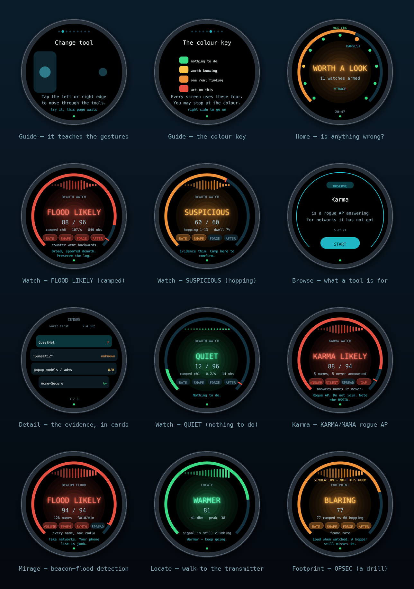
</p>

Regenerate them yourself — and note that the generator **bounds-checks every
primitive against the panel's safe radius**, so "does the UI fit on a circle" is
a CI result rather than an opinion:

```bash
make -C tools/render        # writes assets/screens/*.png
make -C tools/render check  # asserts nothing escapes the glass
```

### And the panel will send back what it actually drew

The renderer proves the *simulation* fits the circle. It cannot know that a real
font is wider than the 0.6em the layout was solved with, or that an engine
produced a string only live air can produce. So the device renders its own
widget tree with `lv_snapshot` and streams it back over the console:

```bash
python3 tools/screen/grab.py shot.png            # one face
python3 tools/screen/grab.py shot.png --lens wifi.watch
python3 tools/screen/sweep.py                    # every lens + a contact sheet
python3 tools/screen/sweep.py --detail           # ...and each advice page and row list
```

The sweep runs the **same safe-radius check against the real capture** that
`tools/render check` runs against the simulation, and fails if any lit pixel
escapes the glass.

Every payload line is marked and the stream is checksummed, because the first
version of this was not: the logger shares that console, and a log line landing
mid-transfer was spliced into the payload and every pixel after it invented. The
host now **refuses to write a file it cannot verify** rather than showing you a
picture that is not what the panel drew.

> Needs `pyserial` and `pillow`. Run it from a shell where ESP-IDF's
> `export.sh` has **not** been sourced — that swaps the interpreter for one
> without them.

### And the parsers are fuzzed under sanitizers

Every 802.11 frame and BLE advertisement this firmware reads is a buffer
somebody else chose. The engines are pure C11 with no allocation, so that
entire surface is reachable from the host:

```bash
make -C test/fuzz                          # ~200k inputs + 50k streams
make -C test/fuzz long                     # a million
make -C test/fuzz replay SEED=12345        # one input, to reproduce a failure
make -C test/fuzz replay-state SEED=12345  # one verdict stream, likewise
```

It builds with **ASan and UBSan on by default** — without them it would only
prove the parsers return — and each input is handed to the targets in a
heap block of exactly its own length, so a walker that steps one byte past
its limit is caught rather than landing harmlessly in a larger buffer.

### And the verdicts are fuzzed too

Surviving hostile bytes is the smaller half of the promise. What this device
actually claims is about what it *says*: that a number on the glass never
exceeds the ceiling its evidence earned, that it never reaches certainty, and
that a headline is never richer than what was observed. Those live in
sequences of observations over time, so a buffer fuzzer cannot reach them.

The second harness drives the scoring engines with random event **streams**
and checks the invariants after every step — with time deliberately
misbehaving, because the Wi-Fi driver callback, the NimBLE host task and the
dwell ring are three producers with their own clocks reaching one consumer.
Timestamps arrive out of order, repeat, and jump by an hour.

It also reports which guarded states it actually reached, and fails if one was
never exercised — an invariant behind an `if` proves nothing when the condition
never holds, and a fuzzer that never reaches the interesting state passes
silently and looks like evidence.

It has already paid for itself four times:

- **Twin's verdict depended on the order the scan filled its table.** Three
  tie-breaks resolved to whichever access point sat earlier in the array, so
  one unchanged room could score 78 on one sweep and 88 on the next. Ties are
  broken on the lowest address now, which makes the verdict a function of the
  group rather than of the scan order.
- **Aegis would publish certainty if a contributing engine regressed.** It
  takes each detector's own score and ceiling on trust, and the overall
  ceiling is a *minimum* — so an impossibly high contributor never lowered it
  and went straight to the glass. The numbers are clamped at the door now, and
  the aggregate ceiling is bounded by `PA_CEILING_MAX`, which is 99 and not
  100 on purpose.
- **Flood treated an unmeasured window as a ten-second one.** A `window_ms`
  of 0 means the caller never timed the sweep, and it was being substituted
  with ten seconds and then used as the denominator of a churn rate — so the
  engine published SUSPICIOUS off a window nobody had timed. The clearest
  statement of it is in the test: the same 24 networks scored **58 blind and
  51 timed**, so failing to measure made the detector *more* confident.
- **Two of its own first invariants were wrong**, which is worth recording:
  one assumed Census's four component scores were ceilings, and one assumed a
  uniformly badly configured roaming group must score zero. Both were my
  misreading rather than the firmware's error, and both were caught by
  checking the engine instead of believing the test. A new failing assertion
  is a hypothesis.

The sequence is seeded rather than coverage-guided. That trades some reach for
something worth more in CI: the same seed gives the same bytes on every machine
forever, so a failure is replayable with one number instead of a corpus.

Beyond crashes it asserts post-conditions the sanitizers cannot see — that a
walker terminates, that an output never exceeds the buffer it was given, that
cleaning already-clean text changes nothing, and that a parser's answer about a
*truncated* frame is never richer than its answer about the whole one.

## The lenses

A **lens** is one tool. The dial is built from whatever lenses are compiled in; adding one is adding a single `.c` file. Every lens declares its hardware powers at compile time, and the radio refuses any power a lens did not declare.

| Lens | Team | What it does |
|------|------|--------------|
| **Spectrum** | 🔵 recon | 2.4 GHz airtime waterfall — the map you read the others against. States, permanently, that it is deaf above 2.4 GHz. |
| **Watch** | 🔵 detect | Grades deauthentication / disassociation floods across four evidence families — rate, targeting shape, forgery, and whether the clients actually came back — with a confidence ceiling. The headliner. |
| **Census** | 🔵 audit | Grades every nearby network A+…F on what it would take to break in — auth, 802.11w, cipher, WPS. |
| **Twin** | 🔵 detect | Finds the rogue AP wearing a name that belongs to someone else — and scores BSSID multiplicity at *zero*, because roaming is not an attack. |
| **Karma** | 🔵 detect | Catches the rogue AP that answers to *any* name a passing phone asks for — while scoring a legitimate multi-SSID deployment at zero. |
| **Mirage** | 🔵 detect | Detects the beacon/SSID-spam flood that fills every phone's network list — the exact attack the ESP32 world is famous for — while scoring a dense city as *busy, not hostile*. |
| **Locate** | 🔵 hunt | Once a source is flagged, walk toward it: a smoothed RSSI *hotter / colder / here* game. Finds a transmitter without becoming one. |
| **Aegis** | 🔵 command | **The one screen that tells the story.** Every other lens forgets; Aegis remembers. It latches each finding with the time it happened, so a burst that fired while you were looking at another lens is still there ten minutes later — and it scores a *sequence* (recon → twin → disruption → collection) far above the same alarms in a jumble, because that ordering is an operation rather than a noisy afternoon. |
| **Vigil** | 🟢 personal | **Is an item tracker travelling with you?** The first lens to use the Bluetooth radio. Seeing an AirTag means nothing — a café has a dozen. What matters is whether one is still with you *after you have moved*, so Vigil infers movement from the Wi-Fi landscape turning over and only counts a tag that survives it. Never claims intent, never says you are safe. |
| **Squall** | 🔵 triage | **"The Wi-Fi is down — is it broken, busy, or jammed?"** Three problems with three completely different responses, identical to the user. Squall separates them on the one measure that works: *energy versus decodability*. Loud **and** productive is a busy building. Loud and **barren** — fewer frames per second than a single AP's beacons — is the shape of a jam. A busy office is never called an attack. |
| **Harvest** | 🔵 detect | Catches somebody collecting your handshakes to crack offline — the attack where nothing breaks and nobody complains. Separates the **forced** cycle (knock a client off, catch it reconnecting) from the **clientless PMKID** solicitation, and knows a rebooting router looks identical to one forced cycle. |
| **Sentinel** | 🔵 audit | Answers the question that starts incidents: *what changed since I last swept this site?* Adopt a baseline while the estate is clean, then it diffs every later sweep — new radios, a network that quietly dropped its 802.11w, an AP gone missing — and scores a **downgrade** far above ordinary churn. |
| **Probe** | 🟣 recon | Shows a room what its phones broadcast about their owners, and defeats MAC randomisation to prove the point. Awareness-session gold. |
| **Range** | 🔴🔵 train | Plays synthesised attacks through the **real** detection engines so you can learn to read the gauge. Holds no radio at all. |
| **Footprint** | 🔴 train | The red team's mirror: grades how *detectable* an attack is, names the family that gives it away, and tells you whether a hopping defender would even notice. Receive-only OPSEC. |
| **System** | ⚙️ audit | Battery, region, and live proof the transmit fence is clean. |

Red, blue, and purple all run on the **same engines**. The Range doesn't simulate a detector — it drives the actual one, so what you learn on it is exactly what you see in the field. See [docs/REDBLUE.md](docs/REDBLUE.md) for how Pharos serves each side.

### For red teams: know your own signature

Pharos will not transmit — that's the whole point, and it's why it can go into rooms offensive tools can't. What it gives a red-teamer instead is arguably more valuable: **OPSEC insight**. The **Footprint** lens grades any attack from the defender's side of the glass, against a camped defender *and* a hopping one:

<p align="center">
  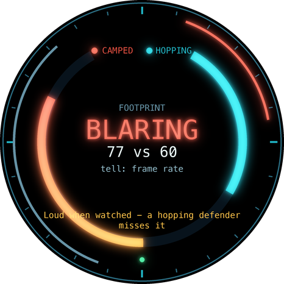
  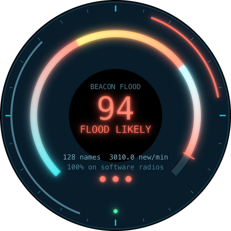
</p>

Left: a broadcast deauth flood reads **BLARING** to a camped defender (88) but only 60 to a hopping one — the dominant tell is *frame rate*, and the takeaway is stated plainly: *loud when watched, a hopping defender misses it*. Right: **Mirage** catching a 300-name beacon flood at **FLOOD LIKELY**, while a dense-city rooftop of 60 real networks scores *busy, not hostile*.

## The transmit fence

Receive-only is the product, so it is enforced four ways, and CI checks all four:

1. **Capability tokens.** Every lens declares its powers at compile time. There is no `CAP_WIFI_TX` token to hold — you cannot request what does not exist.
2. **Link-time wrap fence.** Every Espressif/NimBLE transmit primitive (`esp_wifi_80211_tx`, `esp_wifi_deauth_sta`, `esp_now_send`, AP-mode `esp_wifi_set_mode`, …) is redirected by `-Wl,--wrap` to an abort trap. Call one and the firmware halts at the call site rather than emitting a frame.
3. **Build-time role fence.** NimBLE is compiled **observer-only**; the advertising and connection code is not in the image. The BLE scan is additionally **passive** — an *active* scan answers every advertisement with a `SCAN_REQ`, which is a transmission, so `passive = 1` is audited in CI like every other mechanism.
4. **Source audit.** [`tools/check_tx_fence.sh`](tools/check_tx_fence.sh) greps the tree for transmit primitives and verifies all four mechanisms, on every commit.

The **System** lens reads the fence's own status and shows it on screen. A device that asks to be trusted in a building it does not own can *prove* it is only listening.

```bash
./tools/check_tx_fence.sh        # → FENCE INTACT - receive-only posture verified.
```

## Evidence you can defend

A report anyone can edit afterwards is a note, not evidence. Every record Pharos
commits is hash-linked to the one before it:

```
H(n) = SHA-256( H(n-1) || seq || t_us || kind || payload )
```

Modification, deletion, insertion and reordering are all caught by
`phc_verify` — each has a test. Addresses are redacted **at write time** (OUI-only
or salted-hash), never at export, so a full MAC that was never written cannot
leak from a partition image or a crash dump.

What it deliberately does *not* claim: this is **integrity, not authorship**. A
device you can disassemble cannot keep a signing key from its owner. Publish the
head digest somewhere you don't control — a ticket, a message to the client at
the end of the walk — and you have a timestamp someone else witnessed. That is
the honest version of the guarantee, and it is the one Pharos makes.

## Build & run

**The engines and UI geometry build and test with no board at all** — do this first, it is fast and catches the most:

```bash
make -C test/host                # 15227 checks, 0 failures
```

> [!TIP]
> **⚡ Flash it from your browser — no toolchain.** Open **[at0m-b0mb.github.io/Pharos-ESP32S3](https://at0m-b0mb.github.io/Pharos-ESP32S3/)** in Chrome or Edge, plug the board in over USB-C, and click Install. The page serves the same audited binary as the release and flashes over Web Serial — nothing is uploaded anywhere.

**Prebuilt firmware** is attached to each [release](https://github.com/at0m-b0mb/Pharos-ESP32S3/releases) — a single flashable image built and audited in CI:

```bash
esptool.py --chip esp32s3 write_flash 0x0 pharos-v3.6.1-esp32s3.bin
```

**Build it yourself**, with [ESP-IDF](https://docs.espressif.com/projects/esp-idf/) 5.5 or newer:

```bash
idf.py set-target esp32s3
idf.py build flash monitor
```

The board driver, LVGL, and the panel init come from Waveshare's managed BSP component (pinned in [`main/idf_component.yml`](main/idf_component.yml)); Pharos does not re-drive the AMOLED.

## Architecture at a glance

Two cores, split by role. The radio side has a hard real-time budget and does the minimum; everything that *reasons* runs on the other core, in pure C, against copied data — which is why all of it is testable on a laptop.

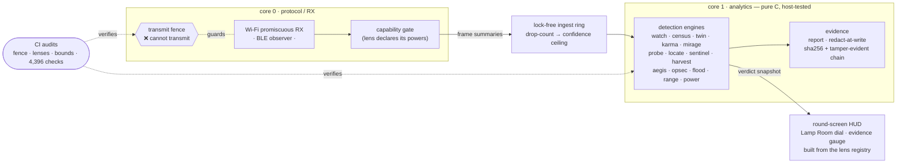

- **`components/pharos_engine/`** — the judgement. Pure C11, no ESP-IDF, no allocation, no floating point in scored paths. Every detector, the evidence chain, and the round-screen maths live here, and every line of it is host-tested.
- **`components/pharos_radio/`** — the only component that touches the radio, and the four-mechanism [transmit fence](#the-transmit-fence) around it.
- **`components/pharos_ui/`** — round-screen geometry, the Lamp Room dial, the evidence gauge — tested as maths before a pixel is drawn — plus the "Virtual Pharos" renderer that produces the screenshots above.
- **`components/pharos_lens_*/`** — one tool each, self-registering via a constructor; `main.c` names none of them.

Full detail in [docs/DESIGN.md](docs/DESIGN.md).

## Documentation

| | |
|--|--|
| [docs/DESIGN.md](docs/DESIGN.md) | Architecture, the honesty model, and how to add a lens. |
| [docs/REDBLUE.md](docs/REDBLUE.md) | How Pharos serves red, blue and purple teams — lawfully. |
| [docs/POLICY.md](docs/POLICY.md) | The safety guardrails, and *why* each one exists. |
| [docs/HARDWARE.md](docs/HARDWARE.md) | The board, the pin map, and every `VERIFY` still open. |
| [docs/SAFETY.md](docs/SAFETY.md) | Legal & ethical use. Read before switching on. |
| [docs/ROADMAP.md](docs/ROADMAP.md) | Milestones M1–M6 and what is proven vs. scaffolded. |
| [CONTRIBUTING.md](CONTRIBUTING.md) | The four rules that are the product, not style. |
| [⚡ Web flasher](https://at0m-b0mb.github.io/Pharos-ESP32S3/) | Flash from Chrome/Edge over USB — no toolchain. |

## Status

**v3.6.1 — every lens verified on the glass, and the verdicts fuzzed as hard as the parsers.**

| Layer | State | Detail |
|---|---|---|
| **Detection & evidence engines** | ✅ complete, **15,227 host checks, 0 failures** | 30 engines, every one pure C11 with no ESP-IDF, no float and no allocation, so the whole analysis surface runs and is tested on a laptop |
| **Hostile-input fuzzing** | ✅ **515,084,483 parser post-conditions**, **50,704,513 verdict invariants** | two seeded harnesses under ASan + UBSan, in CI on every push; the second drives the scoring engines with time deliberately out of order |
| **Round-screen geometry & HUD** | ✅ complete & tested | layout maths host-tested; all 21 lenses photographed off the real panel each release, checked for anything outside the glass |
| **Transmit fence** | ✅ enforced & audited | 4 mechanisms, verified against the linked ELF on every build — receive-only is enforced at link time, not promised in a comment |
| **Firmware build** | ✅ green on ESP-IDF v5.5 + v6.0 | a **flashable binary is attached to each [release](https://github.com/at0m-b0mb/Pharos-ESP32S3/releases)** |
| **Board bring-up** | ✅ running on hardware | CO5300 AMOLED + CST9217 touch, IMU and PMU telemetry live; 9-minute soak with **zero heap drift and zero fence trips** |
| **Watchtower rotation** | ✅ verified on hardware | all 9 armed watches visited across 8 rotations, radio handed over on schedule |

> [!NOTE]
> **The honesty rules are the product.** Nothing here reaches certainty: a
> hopping receiver caps at 60 and a camped one at 96, every verdict names the
> evidence it used, and no string anywhere says a network is safe. Where the
> device cannot tell, it says so instead of guessing — and the test suite
> asserts that in both directions.

**21 lenses** · **30 engines** · a receive-only serial console · MIT.

## License

[MIT](LICENSE) © at0m-b0mb. Built for people who defend networks and the people learning to.
